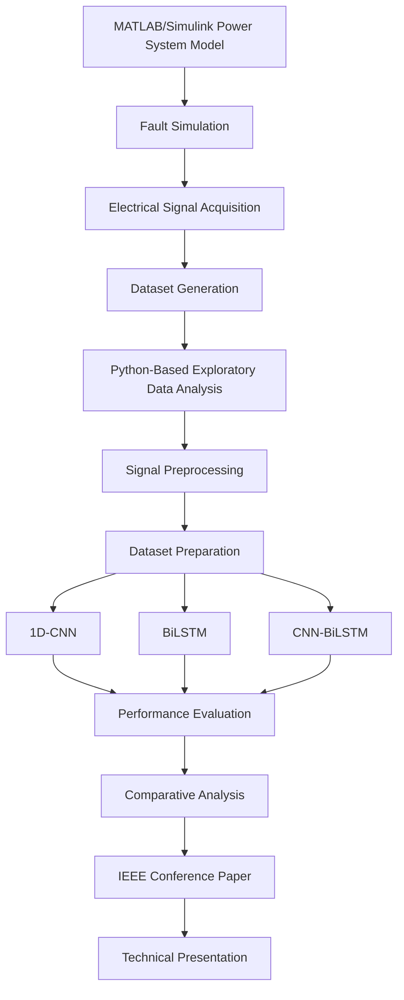

# Transmission Line Fault Classification Using Deep Learning

### An End-to-End MATLAB/Simulink and Python Framework for Intelligent Power System Fault Classification


---

## 1. Project Overview

Transmission line faults are among the major challenges affecting the reliability, stability, and security of electrical power systems. Accurate fault classification is essential for intelligent protection systems and uninterrupted power delivery.

This project presents an end-to-end deep learning framework for transmission line fault classification using multivariate electrical signals generated from a MATLAB/Simulink four-bus, three-line power system.

The research investigates and compares three time-series deep learning architectures:

- **1D Convolutional Neural Network (1D-CNN)**
- **Bidirectional Long Short-Term Memory (BiLSTM)**
- **Hybrid CNN–BiLSTM**

Unlike conventional approaches that depend heavily on manually engineered statistical features, this framework investigates direct learning from raw three-phase voltage and current measurements.

The project covers the complete research workflow, from power system simulation and dataset generation to exploratory data analysis, deep learning experimentation, performance evaluation, IEEE-style conference paper preparation, and technical presentation.

### Project Highlights

- MATLAB/Simulink-based four-bus, three-line power system modelling.
- Generation of 11,879 labeled multivariate electrical signal samples.
- Comprehensive Python-based exploratory data analysis.
- Time-series signal processing and visualization.
- Implementation of three deep learning architectures.
- Comparative evaluation using standard classification metrics.
- Preparation of a six-page IEEE-style conference paper.
- Technical presentation of the research findings.

## 2. Research Objectives

The primary objectives of this project are:

1. Develop a MATLAB/Simulink-based transmission line fault simulation framework.
2. Generate a labeled multivariate electrical signal dataset covering diverse fault scenarios.
3. Investigate electrical signal characteristics through comprehensive exploratory data analysis.
4. Implement different time-series deep learning architectures for fault classification.
5. Compare model performance under identical experimental conditions.
6. Evaluate classification performance using accuracy, precision, recall, F1-score, and loss.
7. Investigate the effectiveness of deep learning for intelligent transmission line protection.

## 3. Research Workflow

The project follows an end-to-end research methodology.



## 4. Power System Modeling and Dataset Generation

A four-bus, three-phase transmission network was developed using MATLAB R2022b and Simscape Electrical.

### 4.1 Simulation Configuration

| Parameter | Configuration |
|---|---|
| Number of buses | 4 |
| Transmission lines | 3 |
| Length of each line | 100 km |
| Generator units | 2 |
| System frequency | 50 Hz |
| Sampling frequency | 2 kHz |
| Sampling interval | 0.0005 s |
| Simulation duration | 0.20 s |
| Fault locations | 1–99 km |
| Fault resistance | 0.25–100 Ω |
| Fault conditions | 5 |

### 4.2 Simulated Fault Conditions

| Fault Type | Description |
|---|---|
| LG | Line-to-Ground Fault |
| LL | Line-to-Line Fault |
| LLG | Double Line-to-Ground Fault |
| LLL | Three-Phase Fault |
| Healthy | Normal Operating Condition |

### 4.3 Fault Resistance Levels

The following eight fault resistance values were considered:

`[0.25, 0.5, 5, 10, 25, 50, 75, 100] Ω`

These values represent both low-impedance and high-impedance fault conditions.

### 4.4 Dataset Specifications

| Parameter | Value |
|---|---|
| Final dataset samples | 11,879 |
| Fault classes | 5 |
| Transmission lines | 3 |
| Fault locations | 99 |
| Fault resistance levels | 8 |
| Input channels | 6 |
| Time-series window | 200 samples |
| Input dimensions | 200 × 6 |

Each sample contains six synchronized electrical signal channels:

- **Va:** Phase-A voltage
- **Vb:** Phase-B voltage
- **Vc:** Phase-C voltage
- **Ia:** Phase-A current
- **Ib:** Phase-B current
- **Ic:** Phase-C current

The dataset also contains metadata describing:

- Transmission line number
- Fault location
- Fault type
- Fault resistance

## 5. Exploratory Data Analysis (EDA)

Comprehensive exploratory data analysis was performed using Python to investigate the statistical and physical characteristics of the generated electrical signals.

### 5.1 EDA Investigations

The analysis covered the following areas:

1. Dataset structure inspection
2. Fault type distribution
3. Transmission line distribution
4. Fault location distribution
5. Fault resistance distribution
6. Voltage signal analysis
7. Current signal analysis
8. Feature correlation analysis
9. Voltage magnitude behavior
10. Current magnitude behavior
11. Frequency spectrum analysis (FFT)
12. Spectrogram analysis (STFT)
13. Wavelet scalogram analysis
14. Fault energy curve analysis
15. Symmetrical component analysis
16. Three-phase trajectory visualization
17. Overall dataset assessment

### 5.2 Signal Analysis

Different signal processing and visualization techniques were investigated to understand the electrical characteristics under different fault conditions.

| Analysis | Purpose |
|---|---|
| Time-domain analysis | Investigate voltage and current variations |
| FFT | Identify frequency-domain characteristics |
| STFT | Analyze time-frequency behavior |
| Wavelet Scalogram | Investigate transient fault characteristics |
| Fault Energy Curve | Examine energy variations during faults |
| Symmetrical Components | Investigate unbalanced fault behavior |
| Three-Phase Trajectory | Visualize three-phase signal characteristics |

These investigations helped examine the fault-related disturbances and assess the suitability of the generated dataset for time-series deep learning.

## 6. Signal Preprocessing

The preprocessing methodology described in the research includes the following operations:

### 6.1 Butterworth Filtering

A fourth-order low-pass Butterworth filter with a 500 Hz cutoff frequency was used to suppress high-frequency numerical artifacts while preserving relevant transient behavior.

### 6.2 Fault Window Extraction

A fixed window of 200 consecutive samples surrounding the fault event was extracted for each sample.

### 6.3 Gaussian Noise Augmentation

Additive Gaussian noise at approximately 1% of the signal standard deviation was introduced to investigate robustness against measurement noise.

### 6.4 Pre-Fault Normalization

Each signal channel was normalized using its pre-fault mean and standard deviation:

`X_norm = (X_window - μ) / σ`

### 6.5 Dataset Labeling

The five operating conditions were encoded for supervised classification:

- LG
- LL
- LLG
- LLL
- Healthy

The resulting input representation is:

`X ∈ R^(N × 200 × 6)`

where N represents the number of samples.

## 7. Deep Learning Architectures

Three time-series deep learning architectures were implemented using Python and TensorFlow/Keras.

### 7.1 One-Dimensional Convolutional Neural Network (1D-CNN)

The 1D-CNN architecture extracts local temporal patterns and transient characteristics directly from multivariate electrical signals using one-dimensional convolutional operations.

### 7.2 Bidirectional Long Short-Term Memory (BiLSTM)

The BiLSTM architecture captures temporal dependencies by processing sequential information in both forward and backward directions.

This allows the model to learn contextual information from the evolution of electrical signals during fault conditions.

### 7.3 Hybrid CNN–BiLSTM

The hybrid CNN–BiLSTM architecture combines convolutional feature extraction with bidirectional temporal learning.

The convolutional layers extract local signal characteristics, while the BiLSTM layers model temporal dependencies.

## 8. Experimental Setup

The models were implemented using TensorFlow/Keras and trained on Google Colaboratory with GPU acceleration.

### 8.1 Training Configuration

| Parameter | Configuration |
|---|---|
| Programming language | Python |
| Deep learning framework | TensorFlow / Keras |
| Computing platform | Google Colab GPU |
| Optimizer | Adam |
| Initial learning rate | 0.001 |
| Loss function | Categorical Cross-Entropy |
| Input shape | 200 × 6 |
| Output classes | 5 |
| Batch Normalization | Enabled |
| Dropout | Enabled |
| Early Stopping | Enabled |
| Learning Rate Scheduler | ReduceLROnPlateau |
| Dataset split | 70% / 15% / 15% |

The dataset was divided into training, validation, and testing subsets. The test set was reserved for final performance evaluation.

### 8.2 Evaluation Metrics

Model performance was evaluated using:

- Accuracy
- Precision
- Recall
- F1-score
- Categorical Cross-Entropy Loss
- Confusion Matrix
- Training and Validation Curves

## 9. Experimental Results and Performance Comparison

The three architectures were evaluated under identical experimental conditions.

### 9.1 Overall Model Performance

| Model | Test Accuracy | Test Loss | Average F1-score |
|---|---:|---:|---:|
| 1D-CNN | 95.85% | 0.1228 | 0.96 |
| **BiLSTM** | **96.13%** | **0.1195** | **0.96** |
| CNN–BiLSTM | 95.85% | 0.1604 | 0.96 |

### 9.2 Key Findings

- All three architectures achieved testing accuracies above 95%.
- BiLSTM achieved the highest classification accuracy of 96.13%.
- BiLSTM also achieved the lowest testing loss of 0.1195.
- All three architectures demonstrated successful convergence.
- The hybrid CNN–BiLSTM architecture did not outperform standalone BiLSTM in this experiment.
- The results demonstrate the potential of learning directly from raw multivariate electrical signals without handcrafted feature extraction.

### 9.3 Best Performing Architecture

**BiLSTM — 96.13% Test Accuracy**

BiLSTM achieved the best overall classification performance among the investigated architectures, indicating that bidirectional temporal modeling can effectively capture fault-related transient behavior in multivariate transmission line signals.

## 10. Technologies and Tools

| Category | Technologies |
|---|---|
| Power System Simulation | MATLAB R2022b, Simulink |
| Programming Language | Python 3.11 |
| Data Analysis | NumPy, Pandas |
| Visualization | Matplotlib, Seaborn |
| Signal Processing | SciPy, PyWavelets |
| Deep Learning | TensorFlow, Keras |
| Model Training | Google Colab GPU |
| Research Documentation | IEEE Conference Paper |
| Presentation | Microsoft PowerPoint |
| Version Control | Git, GitHub |

## 11. Repository Structure

The repository is organized to separate simulation, dataset documentation, exploratory data analysis, deep learning implementation, experimental results, and academic documentation.

```text
transmission-line-fault-classification/
│
├── matlab/
│   ├── power_system_model/
│   ├── dataset_generation/
│   ├── dataset_merging/
│   └── README.md
│
├── data/
│   └── README.md
│
├── notebooks/
│   ├── EDA_On_Fault_Simulated_Data.ipynb
│   ├── CNN_Simulated_Data_Fault_Detection.ipynb
│   ├── BiLSTM_Simulated_Data_Fault_Detection.ipynb
│   └── CNN+BiLSTM_Simulated_Data_Fault_Detection.ipynb
│
├── results/
│   ├── eda/
│   ├── training/
│   ├── evaluation/
│   └── README.md
│
├── paper/
│   └── ieee_conference_paper.pdf
│
├── presentation/
│   └── technical_seminar.pptx
│
├── docs/
│   ├── dataset_generation_methodology.pdf
│   └── eda_report.pdf
│
├── README.md
├── LICENSE
└── .gitignore
```

*Note: This is the planned repository structure. Actual source files, notebooks, and research assets will be added progressively.*

## 12. Research Paper

**Title:**

*Comparative Analysis of Time-Series Deep Learning Models for Fault Classification in Power Transmission Lines Using MATLAB/Simulink-Generated Electrical Signals*

**Author:** Abdullah Al Minhaz

**Affiliation:** Department of Electrical and Electronic Engineering, Jamalpur Science & Technology University, Bangladesh.

**Academic Context:** Technical Seminar 2026.

The six-page IEEE-style research manuscript presents the proposed simulation framework, dataset generation methodology, signal preprocessing pipeline, deep learning architectures, experimental evaluation, and comparative findings.

The manuscript was prepared as part of the academic evaluation requirements of the Technical Seminar course.

## 13. Future Research Directions

Potential extensions of this research include:

- Evaluation using real-world Phasor Measurement Unit (PMU) and Digital Fault Recorder (DFR) data.
- Investigation of Transformer-based and attention-based sequence models.
- Integration of Explainable Artificial Intelligence (XAI).
- Joint fault detection, classification, and location estimation.
- Evaluation under different network topologies and operating conditions.
- Investigation of real-time intelligent power system protection.

## 14. Course Supervisor

**Md. Amimul Ihsan**

PhD Researcher, University of Toronto, Canada  
Lecturer (On Study Leave), Department of Electrical and Electronic Engineering  
Jamalpur Science & Technology University (JSTU), Bangladesh.

**Academic Profiles:**

- [Google Scholar](https://scholar.google.com/citations?user=cMSNlgMAAAAJ&hl=en)
- [LinkedIn](https://www.linkedin.com/in/amimul-ihsan-zami010763/)

## 15. Acknowledgement

The author expresses sincere gratitude to **Md. Amimul Ihsan**, Lecturer (on Study Leave), Department of Electrical and Electronic Engineering, Jamalpur Science & Technology University, who is currently pursuing his PhD at the University of Toronto, Canada, for his valuable supervision, academic guidance, constructive feedback, and continuous encouragement throughout this project under the Technical Seminar course.

The author also acknowledges the Department of Electrical and Electronic Engineering, Jamalpur Science & Technology University, for providing the academic environment and support necessary to carry out this work.

## 16. Author

**Abdullah Al Minhaz**

B.Sc. Engineering Student  
Department of Electrical and Electronic Engineering  
Jamalpur Science & Technology University (JSTU), Bangladesh.

**Research Interests:**

- Power System Optimization
- Artificial Intelligence in Power Systems
- Deep Learning and Time-Series Analysis
- Smart Grid and Intelligent Protection Systems
- Biomedical Engineering and Autonomous Systems

**GitHub:** [@abdullahalminhaz](https://github.com/abdullahalminhaz)

---

## License

This project is licensed under the MIT License. See the [LICENSE](LICENSE) file for details.
